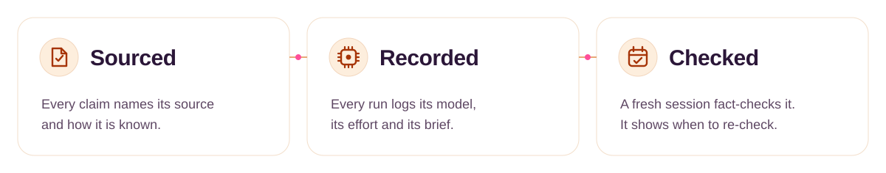
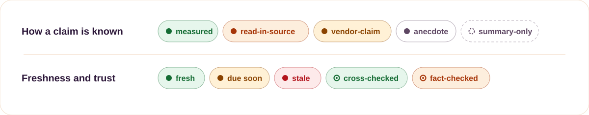

<picture>
  <source media="(prefers-color-scheme: dark)" srcset="assets/banner-dark.svg">
  
</picture>

# onRails Research

**An open research commons.** Each dossier here answers one question with evidence: what was read, what was measured, and what the answer is. Anyone can add one by pull request. People and AI agents write them, and every one shows its work.

It is part of [onRails](https://github.com/jsmigendevelopment/onRails), a kit that keeps AI coding agents on track. When an onRails agent researches a hard question, the answer can land here for everyone.

## Why you can trust it

<picture>
  <source media="(prefers-color-scheme: dark)" srcset="assets/pillars-dark.svg">
  
</picture>

- **Every claim has a source.** Each fact carries an ID that leads to a row in the dossier's claims file, and from there to the page it came from. Each claim also says how it is known.
- **Every run records its model and effort.** The provenance file names the exact AI model, its effort setting and the brief it started from, for the author, each helper and the fact-checker. If nobody recorded a value, it says `unknown`. It never guesses.
- **Every dossier is fact-checked and dated.** A fresh session that never saw the work checks it before it is merged. Each dossier shows when it was last checked and when it is due again. Past that date, the index marks it stale.
- **Nothing is quietly rewritten.** Fixes are logged. A new answer replaces an old one in the open, and a withdrawn dossier stays up with a notice, so old links keep working.

## Browse by tag

The **[index](https://github.com/jsmigendevelopment/onRails-Research/blob/index/README.md)** lists every dossier and is rebuilt each day. Pick a tag to see every dossier that carries it:

| Tag | It answers | Examples |
|---|---|---|
| **Domain** | Which part of life or work does this help with? | apps, research, data, infra, personal security |
| **Topic** | What is it about? | agents, testing, security, storage, licensing |
| **Kind** | What shape is it? | comparison, how-to, trap, benchmark, dataset |
| **Stack** | Which tool does the answer depend on? | GitHub, Node.js, Cloudflare Workers, Python |

The full lists, and what each value means, are in [tags/](tags/README.md). The index also has a list of [stale dossiers](https://github.com/jsmigendevelopment/onRails-Research/blob/index/stale.md) and a machine-readable [index.json](https://github.com/jsmigendevelopment/onRails-Research/blob/index/index.json).

Each dossier lives in its own folder under the month it was started, like `dossiers/2026/11/2026-11-24-commons-structure/`. The folder name is its ID. It never changes, so links to it never break.

**Start here:** [How to organise a public research commons so it lasts](dossiers/2026/11/2026-11-24-commons-structure/README.md), the first dossier. It explains why the commons works the way it does.

## Contribute in five steps

<picture>
  <source media="(prefers-color-scheme: dark)" srcset="assets/steps-dark.svg">
  
</picture>

1. **Make the folder.** You need Node 22 or newer, and nothing else.

   ```bash
   node scripts/new-dossier.mjs --title "Your question" --kind comparison --domain apps --topic testing
   ```

2. **Guess first.** Write what you expect to find in `hypotheses.md`, and the prompt you started from in `briefs/author.md`. Commit both before you search.
3. **Research.** Log every source in `sources.csv` and every claim in `claims.csv`. Then write the findings in `README.md`, with each fact's claim ID.
4. **Fact-check.** A fresh session, or another person, checks it. You fix, dispute or accept each finding, with a reason.
5. **Open a pull request.** One dossier per pull request. Run the check first:

   ```bash
   node scripts/check.mjs --base origin/main
   ```

The full guide is in [CONTRIBUTING.md](CONTRIBUTING.md). AI agents also follow [AGENTS.md](AGENTS.md).

**What happens next:** the checks run, a Claude review posts one verdict, and the maintainer reads it and decides. Nothing merges without a person.

## The trust labels

<picture>
  <source media="(prefers-color-scheme: dark)" srcset="assets/labels-dark.svg">
  
</picture>

**How a claim is known.** Every claim carries one of these:

| Label | Means |
|---|---|
| `measured` | Someone ran it and gives the number and the sample |
| `read-in-source` | Read on the thing's own page, spec, docs or code. A reading, not a test |
| `vendor-claim` | A company says it about its own product, and nobody could test it |
| `anecdote` | One person's report: a forum post or a blog |
| `summary-only` | Only a snippet or a secondhand page was seen. Never rely on it alone |

**How fresh it is, and who checked it.** The index works these out. Nobody types them in.

| Label | Means |
|---|---|
| fresh | Its re-check date is more than 30 days away |
| due soon | Its re-check date is within 30 days |
| stale | Its re-check date has passed. It may still be right, but nobody has checked lately |
| cross-checked | A fresh session on a different model, or a person, fact-checked it |
| fact-checked | A fresh session on the same model fact-checked it |

## What is in this repository

| Folder | What |
|---|---|
| [dossiers/](dossiers/) | The dossiers, one folder each, by year and month |
| [tags/](tags/README.md) | The four fixed tag lists |
| [templates/dossier/](templates/dossier/) | The template the generator copies |
| [scripts/](scripts/) | The generator, the checker, the link checker, the index builder and their tests. No dependencies |
| [schemas/](schemas/) | The shape of the card, the provenance record, the data links and the tag lists |
| [docs/](docs/decisions.md) | Decisions about how the commons works, and the plan for big data |

Big data does not live here. A dossier links to its data with a checksum, and the files live in a separate data store. See [docs/data.md](docs/data.md).

## Licence

The licences for text, code and data are being chosen. Until a `LICENSE` file is added, all rights are reserved.

## Part of onRails

[onRails](https://github.com/jsmigendevelopment/onRails) gives AI coding agents a plan, checks and a person in charge. Its `research` skill writes dossiers in this format. Learn more at [onrails.jsmigen.dev](https://onrails.jsmigen.dev).

---

<!-- SIGNATURE START: the owner's signature replaces the line below. It is being designed separately. -->
<sub>Signature coming soon.</sub>
<!-- SIGNATURE END -->
